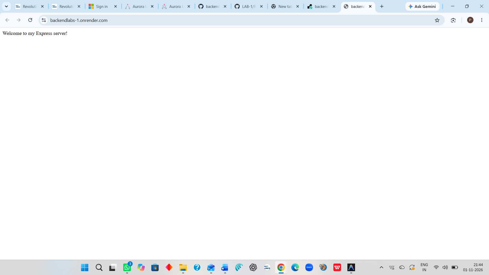
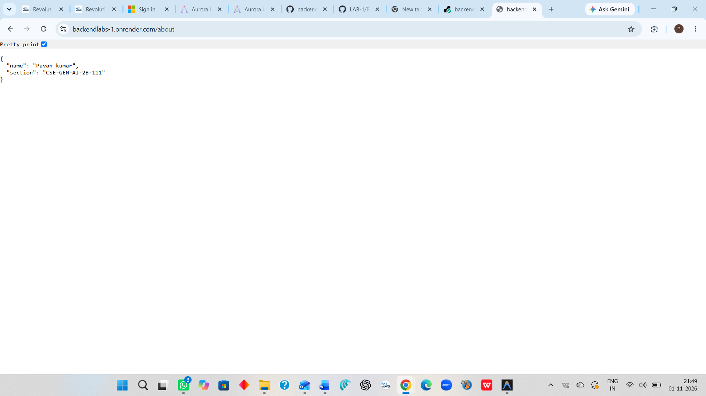
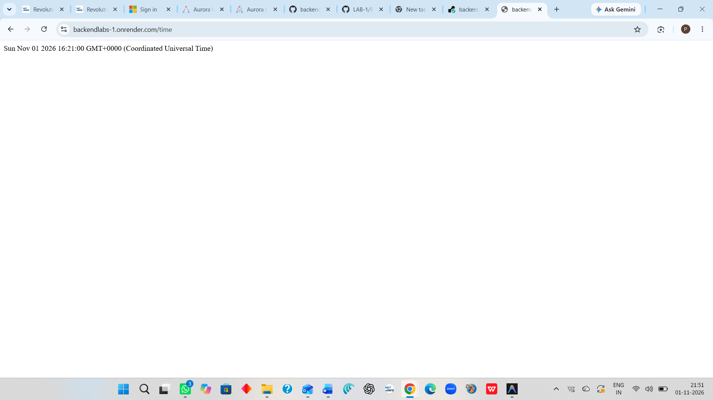
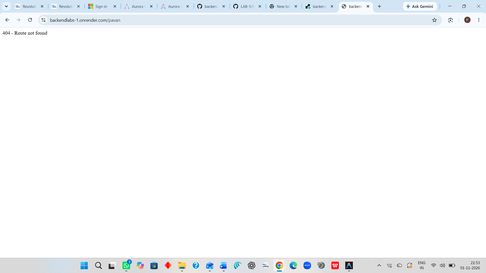

# Lab 1: Node.js and Express server

**Name:** MOTHE PAVAN KUMAR · **Registration number:** 252U1R9100 · **Section:** CSE-GEN-AI-2B-111

**Live link:** PASTE PUBLIC URL HERE (or explain why the project could not be deployed and add Postman screenshots)

## How to run

```bash
cd lab-01
npm install
npm start          # Express server on http://localhost:3000
npm run plain      # plain http server (Task 3), also on port 3000
```

Environment variables: `PORT` (optional, defaults to 3000). No secrets are needed for this lab.

## Endpoints

| Method | Path     | Description                                  | Status |
| ------ | -------- | -------------------------------------------- | ------ |
| GET    | `/`      | Welcome text                                 | 200    |
| GET    | `/about` | JSON with my name and section                | 200    |
| GET    | `/time`  | Current date and time from `new Date()`      | 200    |
| GET    | any other path | "404 - Route not found" message        | 404    |

## Screenshots






## Package.json fields (Task 1)

- `name`: the project's name.
- `version`: the current version of the project.
- `description`: a short summary of what the project does.
- `main`: the entry file when the project is imported as a module.
- `scripts`: shortcut commands run with `npm run <name>` (`npm start` for `start`).
- `keywords`: search terms if the package is published.
- `author`: who wrote it.
- `license`: the licence the code is shared under.
- `dependencies`: packages needed to run the project (Express).

## Notes

- `package.json` lists what the project needs; `node_modules` holds the actual downloaded packages, so it is not committed and can be recreated with `npm install`.
- Problems faced and how I solved them: ADD YOUR OWN NOTES HERE.
